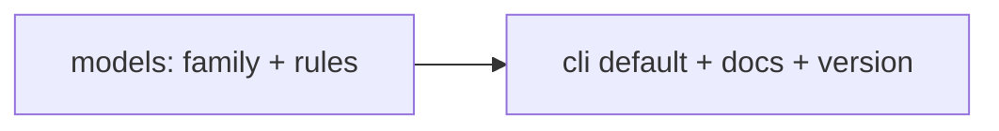

# moxtral 0.5.0 Voxtral 3: implementation plan

**Goal:** scope the language/timestamps rule to Voxtral 2, add Voxtral 3 rules, switch the default model.
**Architecture:** one pure helper `model_family` in `models.py`; validation stays in
`build_transcription_request`; CLI default and docs follow.
**Tech stack:** Python 3.11+, uv, Click, pytest, ruff (`E,F,I,UP,B,SIM,RUF`, line length 88), pyright strict.
**Spec path:** docs/superpowers/specs/2026-10-26-voxtral-3.md
**Detail:** tests
**Target-min:** 6

## Global constraints

- Test command: `uv run pytest -q`; lint `uv run ruff check . && uv run pyright`.
- Repo patterns: `from __future__ import annotations`, frozen slotted dataclasses, errors via
  `moxtral.errors.InputError`, tests in `tests/test_models.py` and `tests/test_transcribe_cli.py`
  (harness fixture with `FakeGateway`).
- Exact strings: default model `voxtral-mini-transcribe-3`; errors as in spec section 3.
- V2 prefixes: `voxtral-mini-latest`, `voxtral-mini-2602`, `voxtral-mini-2507`, `voxtral-mini-transcribe-2507`,
  `voxtral-small-latest`, `voxtral-small-2507`, `voxtral-mini-transcribe-realtime-2602`.
  V3 prefixes: `voxtral-mini-transcribe-3`, `voxtral-small-transcribe-3`, `voxtral-mini-transcribe-latest`,
  `voxtral-small-transcribe-latest`, `voxtral-mini-transcribe-realtime-3`. Match is `model == p or model.startswith(p + "-")`, plus exact `voxtral-mini-transcribe-3`/`voxtral-small-transcribe-3` with suffix `-0` etc. (`startswith(p)` is enough for v3; use exact-or-dash for v2).
- No change to the NDJSON schema, exit codes or `schema.py`.

## Main diagram

```mermaid
%% schedule
gantt
  title Predicted schedule (mm:ss)
  dateFormat X
  axisFormat %M:%S
  section lane 1
  M1 model family rules :m1, 0, 196s
  M2 cli default  docs  version :m2, 196, 294s
```

critical path: M1 → M2 (8.2 min) · peak width 1 · predicted build 8.2 min · predicted total ≈ 11.7 min (target ✗ 6.0)

Ruling: sequential - M2's CLI tests exercise the v3 rules through `build_transcription_request`.

## File structure

| File | Responsibility |
|---|---|
| `src/moxtral/models.py` | `model_family`, validation rules |
| `tests/test_models.py` | rule tests |
| `src/moxtral/cli/transcribe.py` | default model, help text |
| `src/moxtral/data/agent_guide.md`, `README.md`, `CHANGELOG.md`, `pyproject.toml`, `uv.lock` | docs and version |
| `tests/test_transcribe_cli.py` | help default and v3 pass-through tests |

## Predicted schedule

(generated by `schedule --insert`)

## Tasks

### M1 model family rules · Complexity 4 · Est. context 36k
**Owns:** src/moxtral/models.py, tests/test_models.py
**Components:** 1
**LOC owned:** 90
**Tests:** fast
**Model:** sonnet
**Est. time:** 2.5 min
**Produces:** models.ModelFamily = Literal["v2", "v3", "unknown"] · models.model_family(model: str) -> ModelFamily · models.DEFAULT_TRANSCRIPTION_MODEL = "voxtral-mini-transcribe-3" · build_transcription_request (existing signature) with the family rules from spec section 3
e.g. model_family("voxtral-small-transcribe-3") -> "v3"; model_family("voxtral-mini-transcribe-3-0") -> "v3"; model_family("voxtral-mini-latest") -> "v2"; model_family("voxtral-mini-latest-x") -> "unknown"; model_family("my-finetune") -> "unknown"
e.g. build_transcription_request(source=s, model="voxtral-small-transcribe-3", language="de", timestamps=("segment",)) -> TranscriptionRequest(language="de", timestamps=("segment",))
e.g. build_transcription_request(source=s, model="voxtral-small-transcribe-3", diarize=True) -> timestamps == ("segment",)
**Review Focus:** `test_v2_language_with_timestamps_rejected` (message contains "Voxtral 2"); `test_v3_word_timestamps_rejected` (message contains "segment"); `test_unknown_model_has_no_family_rules` (language + word + diarize all accepted); `test_v3_diarize_adds_segment_once` (diarize + ("segment",) -> ("segment",) not duplicated); `test_request_metadata_reflects_auto_added_segment`
**Steps:** 1 failing tests (rewrite `test_language_is_incompatible_with_timestamps` to use a v2 model), 2 FAIL, 3 implement, 4 PASS, `uv run pyright` clean

### M2 cli default, docs, version · Complexity 2 · Est. context 34k
**Owns:** src/moxtral/cli/transcribe.py, src/moxtral/data/agent_guide.md, README.md, CHANGELOG.md, pyproject.toml, uv.lock, tests/test_transcribe_cli.py
**Components:** 2
**LOC owned:** 80
**Tests:** fast
**Kind:** mechanical
**Model:** haiku
**Est. time:** 2 min
**Consumes:** models.DEFAULT_TRANSCRIPTION_MODEL (M1) · models.build_transcription_request (M1)
**Produces:** CLI `--model` default `voxtral-mini-transcribe-3` (help shows it) · docs and `0.5.0` version
**Review Focus:** `test_help_describes_sources_options_and_defaults` updated to the new default; `test_language_and_segment_timestamps_reach_gateway_on_default_model` (`--language de --timestamps segment` -> gateway request has both, exit 0); `test_word_timestamps_on_default_model_fail_without_gateway_call` (exit 2, gateway not called); `test_v2_model_keeps_language_timestamps_exclusion` (`--model voxtral-mini-latest --language de --timestamps segment` -> exit 2)
**Steps:** 1 tests, 2 FAIL, 3 set default via `DEFAULT_TRANSCRIPTION_MODEL`, 4 README option table + replace the "cannot be combined" blockquote with the per-family table from spec section 2, agent_guide line 46-48 likewise, CHANGELOG `## [0.5.0] - 2026-10-26` (Added: Voxtral 3 rules; Changed (breaking): default model), `uv version 0.5.0` then `uv lock`, 5 PASS, `uv run ruff check .`, `uv run pyright`
**Notes:** keep `test_version.py` passing (it reads the version from package metadata). Do not touch `schema.py`.

## Review Focus (probe plan)

Package `moxtral`: app type CLI. Categories: protocol (flags and exit codes), state (dedupe fingerprint
includes auto-added `segment`). Specific risks: default change silently altering old pipelines; a v3
prefix matching a v2 name.
**Probe entry:** run=uv run moxtral · call=moxtral.models.model_family

## Self-review

Spec 3.1-3.3 -> M1; 3.4 -> M2; 4 -> both tasks' Steps. No placeholders; Consumes match Produces; one
edge, justified by a ruling; no shared files.
